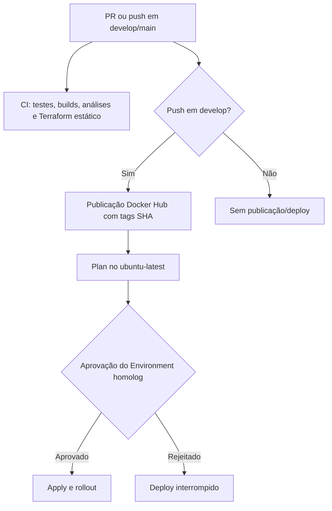

# AutoFlow

Sistema de gerenciamento de ordens de serviço para oficinas mecânicas. Controla o ciclo completo de atendimento:
abertura de OS, diagnóstico, orçamento, execução e encerramento, com controle de acesso por perfil e área do cliente.

---

## Estrutura do Repositório

```
autoflow/
├── backend/    # API REST — Java 21 + Spring Boot
└── frontend/   # SPA — Angular 17 + Angular Material
```

---
## Documentação do Projeto

Este README é o ponto de entrada da entrega. Para os detalhes técnicos, consulte:

- [Backend](backend/README.md): API Spring Boot, configuração, testes, Swagger e Docker.
- [Frontend](frontend/README.md): aplicação Angular, rotas, configuração e execução.
- [Arquitetura do backend](docs/architecture.md).
- [Diagramas de sequência](docs/diagramas-sequencia/diagrama-sequencia.md).
- [Fluxo de orçamento público](docs/fluxo-orcamento-publico.md).
- [Contrato OpenAPI versionado](docs/openapi/autoflow-api.json) e [documentação da API](docs/openapi/README.md).

---

## Stack

Java 21 e Spring Boot; Angular; PostgreSQL; Docker; Kubernetes; Terraform; GitHub Actions; OpenAPI/Swagger;
JUnit, SonarQube e Snyk.

---

## Arquitetura

### Backend — Clean Architecture

O AutoFlow é um monólito Spring Boot organizado segundo a Clean Architecture. O backend possui as camadas
`presentation`, `application`, `domain`, `infrastructure` e `config`.

A direção principal das dependências é `presentation → application → domain`. A camada `infrastructure` implementa
detalhes técnicos e as portas definidas pela `application`, enquanto `config` realiza a composição da aplicação.

Os detalhes da organização e das regras arquiteturais estão em [`docs/architecture.md`](docs/architecture.md).

### Frontend — Angular Standalone + Signals

O frontend usa componentes standalone, lazy loading, Signals, guards funcionais e interceptors JWT. Para rotas,
estrutura e instruções específicas, consulte o [README do frontend](frontend/README.md).

---

## Funcionalidades

O sistema oferece cadastro de clientes, veículos, serviços e peças; abertura e execução de ordens de serviço;
orçamentos com PDF e aprovação autenticada ou pública; reparos adicionais; notificações por e-mail; e área do cliente.

---

## Dados de demonstração

As migrations de desenvolvimento incluem dados para avaliação local. Consulte a configuração local e as migrations para obter os dados de teste. Não publique CPF/CNPJ ou senhas e não use dados de demonstração em produção.

---

## Principais Fluxos

O sistema cobre o ciclo completo da OS, geração e aprovação de orçamentos, download de PDF, reparos adicionais e
acompanhamento público por token. Consulte os [diagramas de sequência](docs/diagramas-sequencia/diagrama-sequencia.md)
e o [fluxo de orçamento público](docs/fluxo-orcamento-publico.md) para os detalhes.

Para rotas, estrutura e instruções específicas da aplicação web, consulte o [README do frontend](frontend/README.md).

---

## Execução local

Pré-requisitos: Java 21, Maven, Node.js 20, npm, PostgreSQL e, opcionalmente, Docker. Os detalhes de cada aplicação
estão nos READMEs do [backend](backend/README.md) e do [frontend](frontend/README.md).

```bash
# backend
cd backend
mvn spring-boot:run

# frontend, em outro terminal
cd frontend
npm install
npm start
```

O backend fica disponível em `http://localhost:8081` e o frontend em `http://localhost:4200`.

## Docker Compose

Na raiz do repositório, suba a stack completa com:

```bash
docker compose up -d
```

## Kubernetes local 

Os manifestos Kubernetes da entrega em [k8s/](k8s/) e do perfil local em [k8s-local/](k8s-local/) estão versionados.
Manifests `secret.yaml` com valores não são versionados; em um clone novo, crie o Secret local a partir do modelo sem
credenciais e preencha-o somente com valores locais. É necessário ter Minikube, Kind ou Kubernetes habilitado no Docker
Desktop:

Os manifests de `k8s-local/` são para desenvolvimento local. A configuração de homologação declara Services NodePort
privados alcançáveis pelo ALB interno integrado ao API Gateway. Após reset do Learner Lab, reexecute as pipelines CI/CD
para provisionar novamente os recursos do ambiente.

```bash
cd k8s-local
cp secret.yaml.example secret.yaml
# Preencha localmente os campos POSTGRES_DB, POSTGRES_USER, POSTGRES_PASSWORD,
# SPRING_DATASOURCE_USERNAME, SPRING_DATASOURCE_PASSWORD, JWT_SECRET,
# MAIL_PASSWORD e APP_PUBLIC_TOKEN_SECRET antes de aplicar.
minikube start
kubectl apply -f configmap.yaml
kubectl apply -f secret.yaml
kubectl apply -f postgresql-service.yaml
kubectl apply -f postgresql-statefulset.yaml
kubectl apply -f .
kubectl get pods
```

O frontend fica disponível em `http://localhost:30180` e o backend em `http://localhost:30080`.

---

## Terraform na AWS

O código Terraform de deploy da aplicação está em [infra/](infra/). A plataforma EKS, o API Gateway HTTP, o VPC Link,
o ALB interno, IAM e os recursos compartilhados pertencem ao repositório
[autoflow-infra](https://github.com/autoflow-fiap/autoflow-infra). Este repositório gerencia Deployments, Services
internos/NodePort privados e a configuração Nginx do frontend.

O state do root `infra/` usa a key S3 `application/autoflow/terraform.tfstate`. Configure o bucket e a key aprovados
por variáveis do ambiente; o workflow confirma que o objeto remoto existe antes do Terraform. O backend exige
`AWS_TERRAFORM_STATE_BUCKET`, `AWS_TF_STATE_KEY`, `AWS_RDS_STATE_KEY` e
`API_GATEWAY_CORS_ORIGINS`. A origem HTTPS é consultada automaticamente na API Gateway recriada; a API de negócio e o frontend são publicados nessa mesma origem; não há
Ingress, plugin ou upstream Kong na arquitetura de aplicação.

Para a configuração por nome de GitHub Actions, Terraform, runtime e Kubernetes, consulte o [catálogo de variables e secrets](docs/variables-and-secrets.md) e o [histórico](docs/variables-changelog.md). Esta seção descreve a operação do Secret Kubernetes; a documentação operacional do pipeline permanece em [CI-CD-AWS.md](.github/CI-CD-AWS.md).

### Escalabilidade declarada do backend

O Terraform da aplicação gerencia o manifesto [`k8s/hpa.yaml`](k8s/hpa.yaml) como `kubectl_manifest.backend_hpa`, após o Deployment do backend. O HPA solicita de 1 a 3 réplicas e CPU média-alvo de 50%. Em `kubectl_manifest.backend_deployment`, `ignore_fields = ["spec.replicas"]` deixa esse campo sob controle do HPA, sem que o Terraform reverta a quantidade de réplicas em cada aplicação.

A configuração do HPA está integrada ao Terraform e é provisionável pela pipeline da aplicação. Após reset do Learner Lab, reexecute as pipelines CI/CD para provisionar novamente os recursos do ambiente.

## Segredos Kubernetes da aplicação

O Secret `autoflow-secrets`, no namespace `default`, é consumido somente pelo backend; o frontend não o utiliza. Em homologação, a pipeline mapeia GitHub Secrets para esse Secret usando `scripts/apply_k8s_secret.py`, que envia o manifesto por stdin sem gravá-lo em arquivo ou log e reinicia o backend. Consulte o [catálogo de variables e secrets](docs/variables-and-secrets.md) e [Operação de CI/CD](.github/CI-CD-AWS.md) para os nomes e etapas do fluxo.

Para desenvolvimento local, use `k8s-local/secret.yaml.example` e mantenha os valores somente na máquina. Manifests Secret preenchidos foram removidos do Git; `k8s/secret.yaml` não é necessário para o deploy de homologação.

Restrinja o RBAC de leitura e escrita de Secrets, confirme a proteção KMS do cluster e rotacione credenciais que tenham sido versionadas ou persistidas em state. Após reset do Learner Lab, reexecute as pipelines CI/CD para provisionar o Secret e os workloads.

---

## API e OpenAPI

Para demonstrar o login serverless por CPF/CNPJ e o uso do token em rota protegida, consulte a
[demonstração ponta a ponta](docs/openapi/README.md#demonstração-ponta-a-ponta-da-autenticação-serverless) e importe a
[coleção Postman](backend/postman/autoflow-serverless-auth.postman_collection.json).

O [contrato OpenAPI versionado](docs/openapi/autoflow-api.json) é o artefato distribuível da API; a [documentação da
API](docs/openapi/README.md) detalha seu uso. Com o backend em execução, acesse [`http://localhost:8081/swagger-ui.html`](http://localhost:8081/swagger-ui.html)
ou [`http://localhost:8081/v3/api-docs`](http://localhost:8081/v3/api-docs).

---

## Segurança

O acesso às APIs de negócio é controlado por JWT e perfis (`ADMIN`, `ATENDENTE`, `MECANICO` e `CLIENTE`), com endpoints públicos e privados segregados. O frontend envia login ao API Gateway, que invoca a Lambda nativamente; as rotas de negócio seguem pelo VPC Link e ALB interno até o backend no EKS. Não são mantidos credenciais, tokens ou valores reais de ambiente neste README.

---

## Qualidade de Código

Testes automatizados e análises de qualidade e segurança usam JUnit, SonarQube, JaCoCo e Snyk.

## Fluxo do CI/CD

O [workflow do GitHub Actions](.github/workflows/pipeline.yml) executa CI em Pull Requests e pushes para `develop` e `main`. Para `develop`, publica imagens pelo SHA, executa Terraform Plan e Apply no Environment `homolog`, seguido de rollout e smoke tests, respeitando os gates definidos. Plan/Apply usam `ubuntu-latest` com autorização temporária do IP de saída ao endpoint EKS. Após reset do Learner Lab, reexecute as pipelines CI/CD para provisionar novamente o ambiente. Veja [Operação de CI/CD](.github/CI-CD-AWS.md) para pré-requisitos e sequência de provisionamento.


