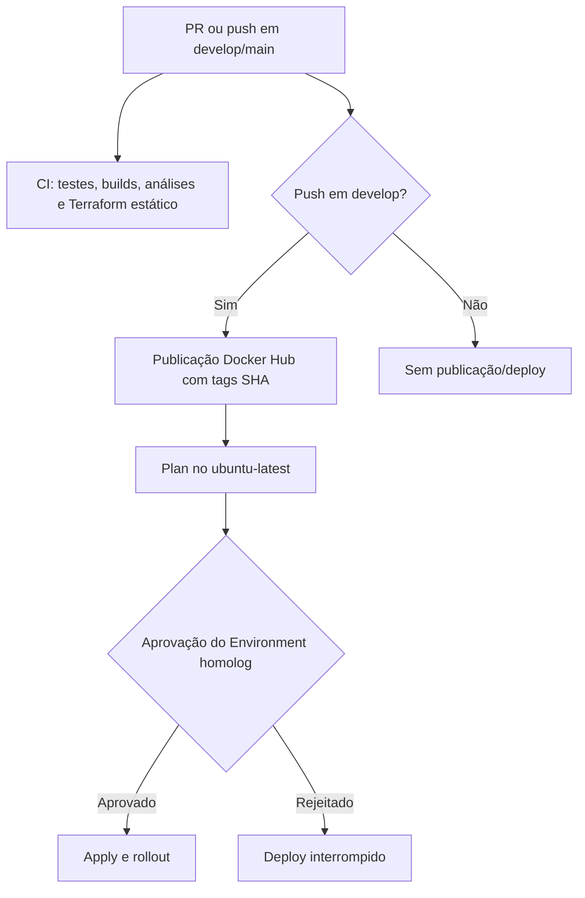
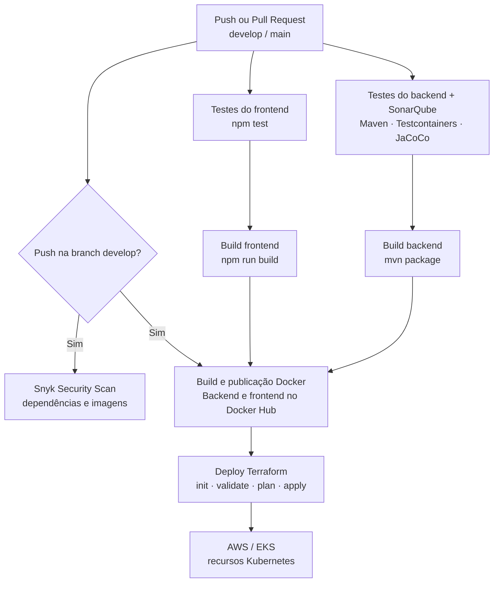

# AutoFlow

Sistema de gerenciamento de ordens de serviço para oficinas mecânicas. Controla o ciclo completo de atendimento:
abertura de OS, diagnóstico, orçamento, execução e encerramento, com controle de acesso por perfil e área do cliente.

---

## Estrutura do Repositório

```
autoflow/
├── backend/    # API REST — Java 21 + Spring Boot
└── frontend/   # SPA — Angular 17 + Angular Material
```

---

## Documentação do Projeto

Este README é o ponto de entrada da entrega. Para os detalhes técnicos, consulte:

- [Backend](backend/README.md): API Spring Boot, configuração, testes, Swagger e Docker.
- [Frontend](frontend/README.md): aplicação Angular, rotas, configuração e execução.
- [Arquitetura do backend](docs/architecture.md).
- [Diagramas de sequência](docs/diagramas-sequencia/diagrama-sequencia.md).
- [Fluxo de orçamento público](docs/fluxo-orcamento-publico.md).
- [Contrato OpenAPI versionado](docs/openapi/autoflow-api.json) e [documentação da API](docs/openapi/README.md).

---

## Stack

Java 21 e Spring Boot; Angular; PostgreSQL; Docker; Kubernetes; Terraform; GitHub Actions; OpenAPI/Swagger;
JUnit, SonarQube e Snyk.

---

## Arquitetura

### Backend — Clean Architecture

O AutoFlow é um monólito Spring Boot organizado segundo a Clean Architecture. O backend possui as camadas
`presentation`, `application`, `domain`, `infrastructure` e `config`.

A direção principal das dependências é `presentation → application → domain`. A camada `infrastructure` implementa
detalhes técnicos e as portas definidas pela `application`, enquanto `config` realiza a composição da aplicação.

Os detalhes da organização e das regras arquiteturais estão em [`docs/architecture.md`](docs/architecture.md).

### Frontend — Angular Standalone + Signals

O frontend usa componentes standalone, lazy loading, Signals, guards funcionais e interceptors JWT. Para rotas,
estrutura e instruções específicas, consulte o [README do frontend](frontend/README.md).

---

## Funcionalidades

O sistema oferece cadastro de clientes, veículos, serviços e peças; abertura e execução de ordens de serviço;
orçamentos com PDF e aprovação autenticada ou pública; reparos adicionais; notificações por e-mail; e área do cliente.

---

## Dados de demonstração

As migrations de desenvolvimento incluem dados para avaliação local. Consulte a configuração local e as migrations para obter os dados de teste. Não publique CPF/CNPJ ou senhas e não use dados de demonstração em produção.

---

## Principais Fluxos

O sistema cobre o ciclo completo da OS, geração e aprovação de orçamentos, download de PDF, reparos adicionais e
acompanhamento público por token. Consulte os [diagramas de sequência](docs/diagramas-sequencia/diagrama-sequencia.md)
e o [fluxo de orçamento público](docs/fluxo-orcamento-publico.md) para os detalhes.

Para rotas, estrutura e instruções específicas da aplicação web, consulte o [README do frontend](frontend/README.md).

---

## Execução local

Pré-requisitos: Java 21, Maven, Node.js 20, npm, PostgreSQL e, opcionalmente, Docker. Os detalhes de cada aplicação
estão nos READMEs do [backend](backend/README.md) e do [frontend](frontend/README.md).

```bash
# backend
cd backend
mvn spring-boot:run

# frontend, em outro terminal
cd frontend
npm install
npm start
```

O backend fica disponível em `http://localhost:8081` e o frontend em `http://localhost:4200`.

## Docker Compose

Na raiz do repositório, suba a stack completa com:

```bash
docker compose up -d
```

## Kubernetes local 

Os manifestos Kubernetes da entrega em [k8s/](k8s/) e do perfil local em [k8s-local/](k8s-local/) estão versionados.
Manifests `secret.yaml` com valores não são versionados; em um clone novo, crie o Secret local a partir do modelo sem
credenciais e preencha-o somente com valores locais. É necessário ter Minikube, Kind ou Kubernetes habilitado no Docker
Desktop:

Os manifests de `k8s-local/` são para desenvolvimento local. A configuração de homologação declara Services NodePort
privados alcançáveis pelo ALB interno integrado ao API Gateway. O Learner Lab foi resetado; a conectividade e o estado
atual dos recursos não foram verificados após recriar a infraestrutura.

```bash
cd k8s-local
cp secret.yaml.example secret.yaml
# Preencha localmente os campos POSTGRES_DB, POSTGRES_USER, POSTGRES_PASSWORD,
# SPRING_DATASOURCE_USERNAME, SPRING_DATASOURCE_PASSWORD, JWT_SECRET,
# MAIL_PASSWORD e APP_PUBLIC_TOKEN_SECRET antes de aplicar.
minikube start
kubectl apply -f configmap.yaml
kubectl apply -f secret.yaml
kubectl apply -f postgresql-service.yaml
kubectl apply -f postgresql-statefulset.yaml
kubectl apply -f .
kubectl get pods
```

O frontend fica disponível em `http://localhost:30180` e o backend em `http://localhost:30080`.

---

## Terraform na AWS

O código Terraform de deploy da aplicação está em [infra/](infra/). A plataforma EKS, o API Gateway HTTP, o VPC Link,
o ALB interno, IAM e os recursos compartilhados pertencem ao repositório
[autoflow-infra](https://github.com/autoflow-fiap/autoflow-infra). Este repositório gerencia Deployments, Services
internos/NodePort privados e a configuração Nginx do frontend.

O state do root `infra/` usa a key S3 `application/autoflow/terraform.tfstate`. Configure o bucket e a key aprovados
por variáveis do ambiente; o workflow confirma que o objeto remoto existe antes do Terraform. O backend exige
`AWS_TERRAFORM_STATE_BUCKET`, `AWS_TF_STATE_KEY`, `AWS_RDS_STATE_KEY` e
`API_GATEWAY_CORS_ORIGINS`. A origem HTTPS é consultada automaticamente na API Gateway recriada; a API de negócio e o frontend são publicados nessa mesma origem; não há
Ingress, plugin ou upstream Kong na arquitetura de aplicação.

Para a configuração por nome de GitHub Actions, Terraform, runtime e Kubernetes, consulte o [catálogo de variables e secrets](docs/variables-and-secrets.md) e o [histórico](docs/variables-changelog.md). Esta seção descreve a operação do Secret Kubernetes; a documentação operacional do pipeline permanece em [CI-CD-AWS.md](.github/CI-CD-AWS.md).

### Escalabilidade declarada do backend

O Terraform da aplicação gerencia o manifesto [`k8s/hpa.yaml`](k8s/hpa.yaml) como `kubectl_manifest.backend_hpa`, após o Deployment do backend. O HPA solicita de 1 a 3 réplicas e CPU média-alvo de 50%. Em `kubectl_manifest.backend_deployment`, `ignore_fields = ["spec.replicas"]` deixa esse campo sob controle do HPA, sem que o Terraform reverta a quantidade de réplicas em cada aplicação.

Isso descreve a configuração versionada, não confirma um HPA ativo ou escala observada no EKS. O Learner Lab foi resetado; a existência do HPA no cluster, a disponibilidade de `metrics.k8s.io` e o funcionamento da escala precisam ser verificados após recriar a infraestrutura. Não há produção declarada como provisionada.

## Segredos Kubernetes da aplicação

O Secret Kubernetes chama-se `autoflow-secrets`, no namespace `default`, e é consumido somente pelo Deployment
`autoflow-backend` via `envFrom.secretRef`. O contrato mantém as chaves `SPRING_DATASOURCE_USERNAME`,
`SPRING_DATASOURCE_PASSWORD`, `JWT_SECRET`, `MAIL_PASSWORD` e `APP_PUBLIC_TOKEN_SECRET`; o Deployment frontend não
consome esse Secret. `k8s/secret.yaml` não é necessário no deploy de homologação: o workflow aplica o Secret diretamente
com `scripts/apply_k8s_secret.py`, usando os GitHub Secrets `AUTOFLOW_DB_USERNAME`, `AUTOFLOW_DB_PASSWORD`,
`AUTOFLOW_JWT_SECRET`, `AUTOFLOW_MAIL_PASSWORD` e `AUTOFLOW_PUBLIC_TOKEN_SECRET`. O arquivo `k8s-local/secret.yaml`
é exclusivo do desenvolvimento local; use `k8s-local/secret.yaml.example` como modelo, substitua todos os valores de
exemplo e mantenha o arquivo preenchido somente na máquina. Os manifests `k8s/secret.yaml` e `k8s-local/secret.yaml`
que continham valores foram removidos do versionamento; somente o exemplo sem credenciais permanece rastreado.

Os Secrets `AUTOFLOW_DB_USERNAME`, `AUTOFLOW_DB_PASSWORD`, `AUTOFLOW_JWT_SECRET`, `AUTOFLOW_MAIL_PASSWORD` e
`AUTOFLOW_PUBLIC_TOKEN_SECRET` são mapeados pelo workflow para atualizar o Secret do workload em homologação. O valor de
`AUTOFLOW_MAIL_PASSWORD` é passado ao script pelo ambiente; o script envia o manifesto por stdin sem gravar o payload em
arquivo ou log. Após aplicar `autoflow-secrets`, o workflow reinicia e aguarda o Deployment `autoflow-backend`. Isso
descreve o pipeline versionado; o estado atual do cluster não foi validado após o reset do Learner Lab. Não há produção
declarada como provisionada.

Para aplicar localmente em um contexto Kubernetes autorizado, forneça essas cinco variáveis no ambiente do processo
a partir de um gerenciador seguro (sem incluí-las em comandos registrados ou arquivos versionados) e execute:

```bash
python scripts/apply_k8s_secret.py
```

O script exige valores não vazios e envia um manifesto efêmero diretamente por stdin; não cria arquivo local. Configure
o RBAC da identidade de deploy com o mínimo necessário: `get`, `create`, `patch` e `update` de Secrets no namespace
`default`, além das permissões estritamente requeridas pelo Terraform para os demais recursos da aplicação. Acesso de
leitura a Secrets deve ser restrito a administradores/operadores autorizados, pois identidades com esse acesso podem
recuperar os valores.

O código local não comprova criptografia em repouso do cluster EKS: o responsável pela plataforma deve confirmar que
o armazenamento de Secrets usa envelope encryption/KMS e políticas de acesso apropriadas antes de homologar. Terraform
não cria mais esse Secret e deixa de receber as credenciais de banco. O bloco `removed` preserva o recurso Kubernetes
existente enquanto o remove do state atual no próximo apply; versões históricas do state ainda podem conter valores
previamente aplicados. O backend S3 declara `encrypt = true`, mas isso, por si só, não elimina cópias antigas nem
comprova KMS. Antes de habilitar o gate, o owner deve avaliar o state histórico e restringir seu acesso; valores que
já foram versionados ou persistidos em state devem ser rotacionados por procedimento operacional aprovado.

---

## API e OpenAPI

Para demonstrar o login serverless por CPF/CNPJ e o uso do token em rota protegida, consulte a
[demonstração ponta a ponta](docs/openapi/README.md#demonstração-ponta-a-ponta-da-autenticação-serverless) e importe a
[coleção Postman](backend/postman/autoflow-serverless-auth.postman_collection.json).

O [contrato OpenAPI versionado](docs/openapi/autoflow-api.json) é o artefato distribuível da API; a [documentação da
API](docs/openapi/README.md) detalha seu uso. Com o backend em execução, acesse [`http://localhost:8081/swagger-ui.html`](http://localhost:8081/swagger-ui.html)
ou [`http://localhost:8081/v3/api-docs`](http://localhost:8081/v3/api-docs).

---

## Segurança

O acesso às APIs de negócio é controlado por JWT e perfis (`ADMIN`, `ATENDENTE`, `MECANICO` e `CLIENTE`), com endpoints públicos e privados segregados. O frontend envia login ao API Gateway, que invoca a Lambda nativamente; as rotas de negócio seguem pelo VPC Link e ALB interno até o backend no EKS. Não são mantidos credenciais, tokens ou valores reais de ambiente neste README.

---

## Qualidade de Código

Testes automatizados e análises de qualidade e segurança usam JUnit, SonarQube, JaCoCo e Snyk.

## Fluxo do CI/CD

O [workflow do GitHub Actions](.github/workflows/pipeline.yml) executa CI em Pull Requests e pushes para `develop` e `main`. Para `develop`, ele declara publicação de imagens pelo SHA, Terraform Plan e Apply no Environment `homolog`, seguido de rollout e smoke tests. A aprovação efetiva depende dos Required reviewers configurados no GitHub; essa configuração e a execução atual não foram verificadas. Plan/Apply usam `ubuntu-latest` com autorização temporária do IP de saída ao endpoint EKS. O Learner Lab foi resetado, portanto o fluxo versionado não comprova recursos implantados. `workflow_dispatch` continua disponível conforme os guards do workflow. Veja [Operação de CI/CD](.github/CI-CD-AWS.md) para pré-requisitos e ativação.



---

## Entrega — Tech Challenge Fase 2 (histórico)

### Objetivos da Fase 2

Evoluir o AutoFlow com Clean Architecture, testes automatizados, APIs operacionais, infraestrutura como código, CI/CD,
deploy em Kubernetes e escalabilidade automática.

### Arquitetura de deploy documentada para a Fase 2

O diagrama a seguir é um registro histórico da entrega da Fase 2; não representa os gatilhos e gates atuais do workflow, descritos na seção anterior.

O modelo de deploy descrito para a Fase 2 combina GitHub Actions, Docker Hub, Terraform, ConfigMaps, Secrets e HPA. O desenho abaixo é histórico e não representa o workflow ou a topologia vigentes. Desde então, `k8s/hpa.yaml` passou a ser gerenciado pelo Terraform da aplicação; sua configuração desejada está descrita em [Escalabilidade declarada do backend](#escalabilidade-declarada-do-backend). A integração no código não comprova existência ou funcionamento do HPA no EKS após o reset do Learner Lab.



Consulte a [fonte Mermaid do diagrama](docs/diagramas-arquitetura/arquitetura-deploy-fase-2.mermaid) e a [documentação
detalhada da arquitetura de deploy](docs/diagramas-arquitetura/README.md).

### Evidências da entrega

- [Manifestos Kubernetes](k8s/)
- [Código Terraform](infra/)
- [Pipeline GitHub Actions](.github/workflows/pipeline.yml)
- [Contrato OpenAPI versionado](docs/openapi/autoflow-api.json)
- [Documentação da API](docs/openapi/README.md)
- [Vídeo demonstrativo da Fase 2](https://youtu.be/ObUkVeYQCOA)
