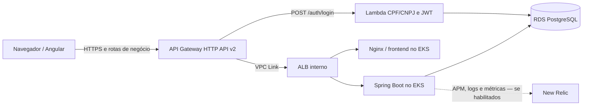

# AutoFlow

Sistema de gerenciamento de ordens de serviço para oficinas. A aplicação reúne uma SPA Angular e um backend Spring Boot
organizado em Clean Architecture. Implementa cadastro e consulta operacional de clientes, veículos, usuários, serviços e
ordens de serviço, além de orçamento público e acompanhamento de status. O schema PostgreSQL é mantido por migrations
Flyway neste repositório.

## Tecnologias e papel na arquitetura

- Backend: Java 21, Spring Boot 3.5, Spring Security, JPA e Flyway.
- Frontend: Angular 17, TypeScript e Angular Material.
- Execução: Docker, Kubernetes e Terraform; CI/CD por GitHub Actions.
- Observabilidade: agente New Relic, logs JSON correlacionados e eventos de negócio.

O Terraform deste repositório gerencia workloads e serviços Kubernetes, ConfigMaps, HPA e configuração Nginx. O
`autoflow-infra` declara VPC/EKS, API Gateway HTTP API v2, VPC Link, ALB interno e integração New Relic;
`autoflow-db` provisiona o RDS; `autoflow-lambda` mantém a autenticação serverless.



Para a arquitetura C4, rede, autenticação e integração entre os serviços, consulte
[arquitetura do API Gateway](https://github.com/autoflow-fiap/autoflow-infra/blob/develop/docs/api-gateway/arquitetura.md).
O fluxo de abertura da OS está em [fluxo_principal.mermaid](docs/diagramas-sequencia/fluxo_principal.mermaid).

## Executar e validar localmente

Requisitos: Java 21, Maven, Node.js 20+, npm 10+ e PostgreSQL. Para subir a stack Compose, configure um `.env` local
com os valores necessários à [aplicação e ao banco local](docs/variables-and-secrets.md) e execute:

```bash
docker compose up -d --build
```

Sem Compose, inicie o backend com PostgreSQL configurado e, em outro terminal, o frontend:

```bash
cd backend
mvn spring-boot:run

# Em outro terminal
cd frontend
npm ci
npm start
```

O backend local usa `http://localhost:8081`; o frontend usa `http://localhost:4200`. Testes e comandos adicionais estão
nos READMEs de [backend](backend/README.md), [frontend](frontend/README.md) e no [guia de qualidade](docs/testing-and-quality.md).

Os [Dockerfiles do backend](backend/Dockerfile) e [frontend](frontend/Dockerfile) são usados para build das imagens.
O CI constrói as imagens sem publicá-las.

Para Kubernetes local, use Minikube, Kind ou Kubernetes do Docker Desktop. O perfil e o exemplo de Secret sem credenciais
estão em [`k8s-local/`](k8s-local/); não reutilize valores locais em AWS.

## API, autenticação e banco

- [OpenAPI versionado e guia da API](docs/openapi/README.md)
- [Especificação OpenAPI JSON](docs/openapi/autoflow-api.json)
- [Coleção Postman de autenticação CPF/JWT](backend/postman/autoflow-serverless-auth.postman_collection.json)
- Swagger local: <http://localhost:8081/swagger-ui.html>; OpenAPI em <http://localhost:8081/v3/api-docs>.
- Diagrama ER e justificativa PostgreSQL: [autoflow-db](https://github.com/autoflow-fiap/autoflow-db/blob/develop/docs/diagrama-er.md)
  e [RFC-001](https://github.com/autoflow-fiap/autoflow-db/blob/develop/docs/RFC-001.md).

O login serverless recebe CPF/CNPJ e senha no API Gateway, que invoca a Lambda. Rotas de negócio usam Bearer JWT; o
backend valida assinatura, claims, estado e perfil atual do usuário. O contrato e os cenários de teste estão no guia
OpenAPI e na [sequência de autenticação](https://github.com/autoflow-fiap/autoflow-infra/blob/develop/docs/api-gateway/arquitetura.md).

O backend envia notificações de ordens de serviço por SMTP.

## Implantação e CI/CD

`develop` corresponde a `homolog`; `main`, a `production`. A ordem de dependências é VPC/EKS, RDS, Lambda, API Gateway,
aplicação e New Relic. Os workflows são independentes; consulte [operação de CI/CD](.github/CI-CD-AWS.md) e
[Variables e Secrets](docs/variables-and-secrets.md).

- `ci.yml` valida Pull Requests para `develop`/`main` e pushes para `develop`, `main` e `feature/**`: testes, builds,
  análise estática/segurança e Terraform sem Apply AWS.
- `pipeline.yml` recebe `push` em `develop`/`main`. O caminho automático exige a Repository Variable correspondente
  (`AUTO_CD_ENABLED_HOMOLOG` ou `AUTO_CD_ENABLED_PRODUCTION`) igual a `true` e sucesso da CI para o mesmo SHA; executa
  Plan, não publica imagens nem aplica recursos.
- No `workflow_dispatch`, `apply=false` executa Plan. `apply=true` publica imagens com tag SHA, gera Plan e solicita
  aprovação separada para Apply e rollout. Smoke tests são executados após o Apply ou por dispatch com
  `smoke_tests_only=true`.
- Os smoke tests usam o Environment validado pelo gate (`homolog` para `develop`, `production` para `main`), inclusive
  na execução isolada. A proteção configurada para esse Environment também se aplica ao job.
- Apply exige `TERRAFORM_APPLY_APPROVAL_CONFIGURED=true` e usa o GitHub Environment selecionado (`homolog` ou
  `production`); configure Required reviewers e restrições de branch nesses Environments. `main` exige proteção de branch.
- `pr-automatico.yaml` cria Pull Request para `develop` conforme seus filtros.

Configure proteção de branch em `develop` e `main` para exigir Pull Request e checks da CI.

O Terraform declara o HPA do backend entre 1 e 3 réplicas, com alvo médio de CPU de 50%; o cluster deve expor
`metrics.k8s.io` para o autoscaling funcionar. O agente APM Java usa `ENABLE_NEWRELIC_APM`; monitoramento Kubernetes,
dashboards, alertas e Synthetic são gerenciados pelo root `autoflow-infra` conforme suas Variables.

## Documentação relacionada

- [Arquitetura e limites das camadas](docs/architecture.md)
- [Diagramas de sequência](docs/diagramas-sequencia/diagrama-sequencia.md)
- [Fluxo de orçamento público](docs/fluxo-orcamento-publico.md)
- [ADR-001 — migração para Clean Architecture](docs/adr/ADR-001-sequencia-migracao-clean-architecture.md)
- [ADR-002 — Kubernetes e Terraform](docs/adr/ADR-002-adocao-kubernetes-terraform.md)
- [Recursos New Relic declarados pela infraestrutura](https://github.com/autoflow-fiap/autoflow-infra/blob/develop/infra/newrelic/README.md)
