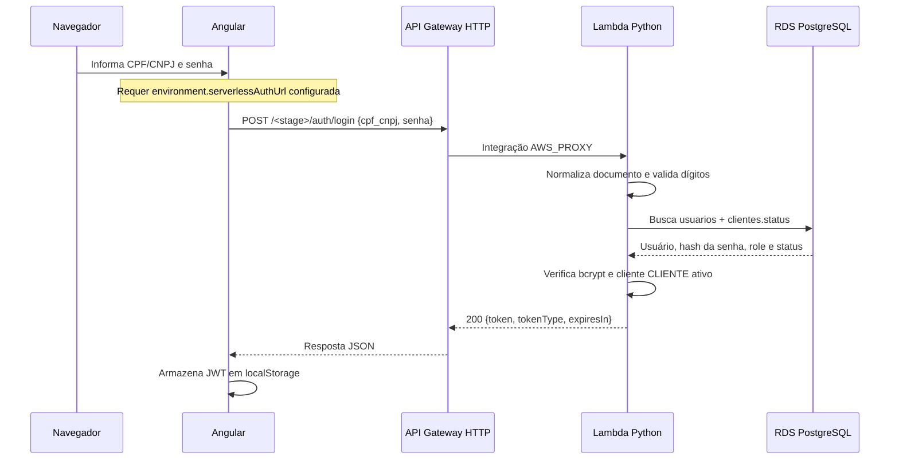
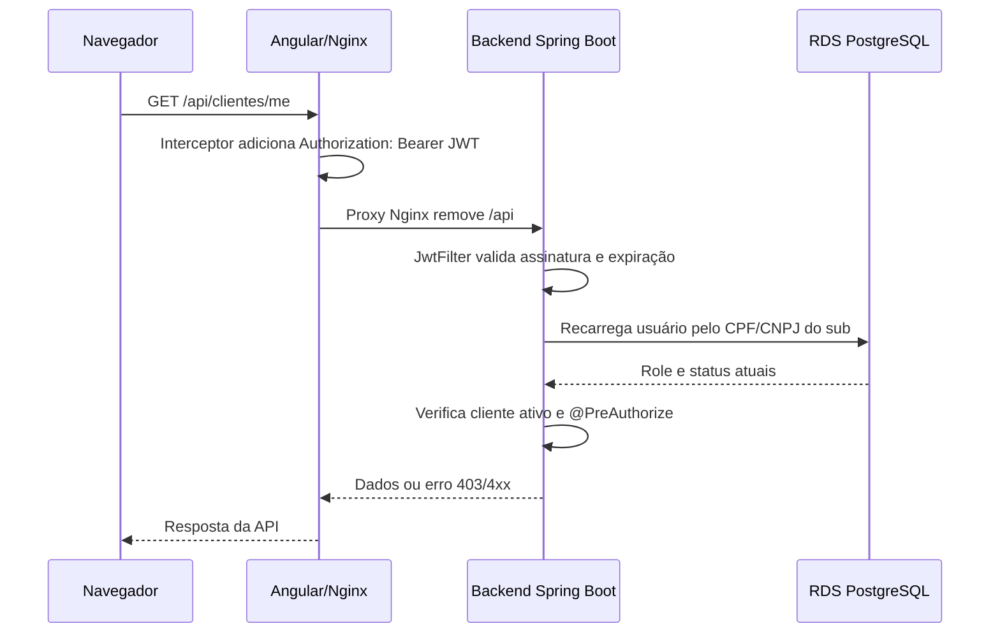
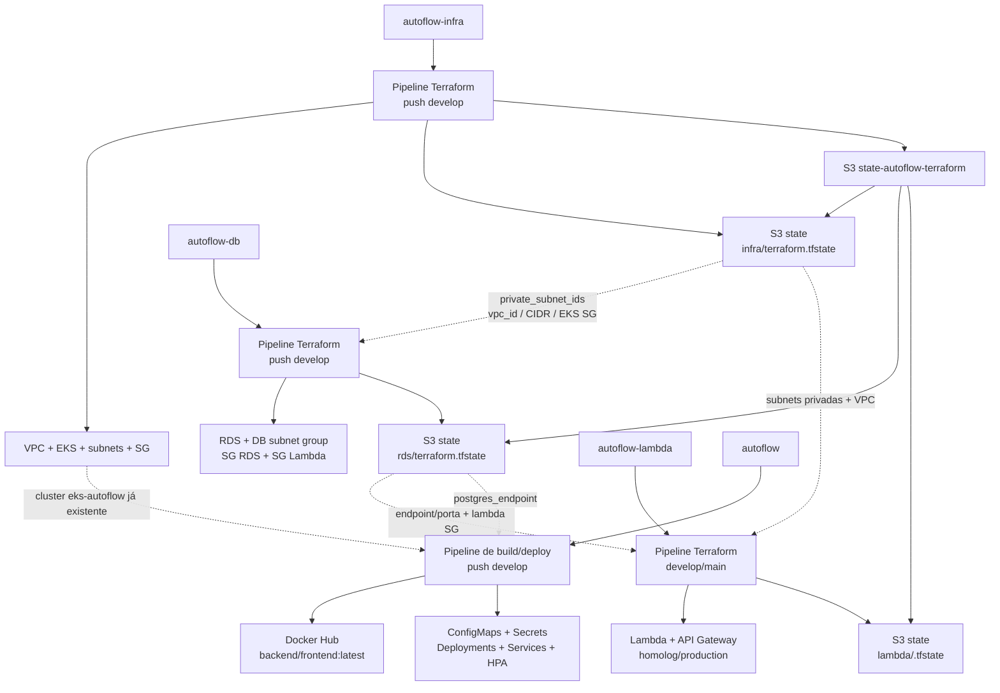

# Baseline histórico anterior à topologia vigente de API Gateway

**Escopo:** integração dos repositórios `autoflow-infra`, `autoflow-db`, `autoflow-lambda` e do repositório da aplicação `autoflow`.

**Status do desenho:** fotografia histórica da arquitetura anterior à adoção do API Gateway como entrada de aplicação por VPC Link/ALB. Os capítulos abaixo preservam aquele baseline e não descrevem a configuração vigente. O Kong não é declarado operacional na topologia atual; os checkouts locais o removem do caminho da aplicação. Consulte a [arquitetura vigente de API Gateway](../../../autoflow-infra/docs/api-gateway/arquitetura.md). Algumas fontes originais do baseline foram removidas; referências nesta seção apontam para seus sucessores atuais e não recriam aquela configuração.

## 1. Resumo executivo

No baseline histórico descrito neste arquivo havia dois caminhos públicos diferentes:

1. O frontend Angular é servido por um `Service` Kubernetes do tipo `LoadBalancer`. As chamadas feitas com o prefixo `/api` passam pelo Nginx do frontend e são encaminhadas diretamente ao `Service` `LoadBalancer` do backend Spring Boot.
2. O login serverless usa um API Gateway HTTP v2 separado. A rota `POST /auth/login` chama uma Lambda Python, que consulta o PostgreSQL RDS e devolve um JWT.

O API Gateway **não** encaminha as APIs de negócio para o backend. Ele não possui authorizer, integração com o backend, VPC Link ou rota curinga. Portanto, a autenticação e as APIs protegidas têm entradas públicas diferentes.

O banco é único para os componentes principais: o backend no EKS e a Lambda de autenticação consultam a mesma instância RDS PostgreSQL.

## 2. Repositórios e responsabilidades

| Repositório | Responsabilidade descrita no baseline | Artefatos principais |
|---|---|---|
| `autoflow-infra` | Rede base e cluster Kubernetes | VPC, subnets públicas/privadas, Internet Gateway, NAT Gateway, Security Group, EKS, node group e estado Terraform |
| `autoflow-db` | Banco gerenciado compartilhado | RDS PostgreSQL, DB subnet group, Security Groups, endpoint/porta e estado Terraform |
| `autoflow-lambda` | Autenticação serverless | Pacote Python, Lambda em VPC, API Gateway HTTP v2, CORS, stages `homolog`/`production` e estados por ambiente |
| `autoflow` | Aplicação e publicação no EKS | Frontend Angular, backend Spring Boot, imagens Docker, manifestos Kubernetes e Terraform que aplica os manifestos no cluster existente |

O quarto repositório é incluído porque os três repositórios de infraestrutura não contêm o código do frontend/backend nem os manifestos que efetivamente publicam a aplicação.

## 3. Topologia de runtime do baseline histórico

O desenho é mantido uma única vez em [`arquitetura-atual-3-repositorios.mermaid`](arquitetura-atual-3-repositorios.mermaid). Este documento registra o contexto histórico e as fontes; não replica o bloco Mermaid para evitar divergência entre cópias.

### 3.1 VPC, subnets e EKS

O `autoflow-infra` cria:

- uma VPC `10.0.0.0/16` com DNS habilitado;
- três subnets públicas em `us-east-1a`, `us-east-1b` e `us-east-1c`, com IP público automático e rota pelo Internet Gateway;
- três subnets privadas nas mesmas Availability Zones, com rota de saída pelo NAT Gateway;
- um NAT Gateway na primeira subnet pública;
- o cluster EKS `eks-autoflow` associado às seis subnets;
- um node group com duas réplicas desejadas, mínimo dois, máximo três, executando nas subnets públicas;
- um Security Group compartilhado pelo cluster EKS, com regras públicas para HTTP/HTTPS, NodePorts internas e tráfego entre os próprios membros do grupo.

O EKS utiliza o `LabRole` configurado em `role_arn` para o cluster e para o node group. O acesso administrativo ao cluster também é concedido por `aws_eks_access_entry` e `AmazonEKSClusterAdminPolicy`.

### 3.2 Kubernetes e entrada do frontend

O repositório `autoflow` aplica os manifestos Kubernetes por Terraform usando o cluster EKS já existente:

- `autoflow-frontend` é um `Deployment` de uma réplica, servido na porta 8080;
- `autoflow-frontend-service` é um `LoadBalancer` na porta 80;
- `autoflow-backend` é um `Deployment` inicialmente com uma réplica, servido na porta 8081;
- `autoflow-backend-service` é outro `LoadBalancer`, expondo a porta 80 e encaminhando para a porta 8081;
- o HPA do backend pode variar de uma a três réplicas com alvo de CPU de 50%;
- as imagens são publicadas no Docker Hub com a tag mutável `latest`.

O Nginx do frontend serve a SPA e trata `/api/` assim:

1. remove o prefixo `/api/`;
2. encaminha a requisição para `BACKEND_URL`;
3. preserva o método, headers de origem e `Authorization` para o backend.

No deploy AWS, `BACKEND_URL` é montado pelo Terraform a partir do hostname retornado pelo `Service` `LoadBalancer` do backend. Assim, o backend também possui uma entrada pública direta, independente do API Gateway.

### 3.3 Banco de dados

O `autoflow-db` lê do state do `autoflow-infra`:

- `private_subnet_ids` para montar o DB subnet group;
- `vpc_id` para criar o Security Group do RDS;
- `vpc_cidr_block` para liberar tráfego PostgreSQL interno;
- `eks_security_group_id` para permitir acesso a partir do EKS.

O RDS atual é PostgreSQL 17, classe `db.t3.micro`, 20 GB, banco `autoflow_db`, porta 5432 e `publicly_accessible = true`. Apesar de estar associado às subnets privadas, essa flag mantém o endpoint com acessibilidade pública potencial; o controle efetivo adicional ocorre pelo Security Group.

O Security Group do RDS permite TCP 5432:

- a partir do Security Group do EKS;
- a partir do CIDR da VPC;
- a partir do Security Group da Lambda exportado pelo próprio state do `autoflow-db`.

O banco está sem criptografia de storage e com `skip_final_snapshot = true` conforme o Terraform atual.

### 3.4 Lambda e API Gateway no baseline histórico

O `autoflow-lambda` cria uma função por ambiente:

| Branch | Ambiente | State Terraform | Nome lógico do stage |
|---|---|---|---|
| `develop` | `homolog` | `lambda/homolog.tfstate` | `homolog` |
| `main` | `production` | `lambda/production.tfstate` | `production` |

A Lambda:

- usa Python 3.12, 256 MB e timeout de 15 segundos;
- é empacotada com `psycopg2`, `bcrypt` e `PyJWT`;
- executa nas subnets privadas exportadas pelo state de `autoflow-infra`;
- usa o Security Group `lambda_security_group_id` exportado pelo state de `autoflow-db`;
- recebe endpoint, porta, nome, usuário e senha do banco por variáveis de ambiente Terraform;
- recebe `JWT_SECRET` e `JWT_EXPIRES_IN_SECONDS` por variáveis de ambiente.

O API Gateway é um `aws_apigatewayv2_api` com `protocol_type = "HTTP"`. Seu desenho atual é:

- uma API independente para cada ambiente;
- CORS configurado para as origens de `frontend_allowed_origins`;
- métodos CORS `POST` e `OPTIONS` e header `content-type`;
- integração `AWS_PROXY` com payload format 2.0;
- rota única `POST /auth/login`;
- permissão para o API Gateway invocar a Lambda;
- stage com nome do ambiente e `auto_deploy = true`;
- os `.tfvars` versionados informam apenas o ambiente; sem override, `frontend_allowed_origins` usa o default `http://localhost:4200`;
- sem authorizer;
- sem integração HTTP com o backend;
- sem VPC Link, NLB ou rota `ANY /{proxy+}`.

Logo, a URL atual tem o formato:

```text
https://<api-id>.execute-api.<regiao>.amazonaws.com/<ambiente>/auth/login
```

O API Gateway só participa do login serverless. Chamadas para `/clientes`, `/veiculos`, `/ordens-servico`, `/orcamentos` e demais rotas da aplicação não passam por ele.

### 3.5 Aplicação e persistência funcional

O backend é um monólito Spring Boot 3.5/Java 21 organizado em Clean Architecture, com controllers HTTP, casos de uso, regras de domínio e adapters de persistência. Os principais contextos funcionais são usuários, clientes, veículos, serviços, peças/insumos, ordens de serviço, diagnóstico, orçamento, reparos adicionais, notificações e acompanhamento público.

As migrações Flyway ficam no repositório `autoflow` e são executadas pelo backend contra o PostgreSQL. O repositório `autoflow-db` provisiona somente a instância RDS, subnet group e regras de rede; ele não cria o schema funcional da aplicação.

O backend também integra com SMTP para notificações e mantém tokens públicos próprios para orçamento e acompanhamento. Esses tokens são diferentes do JWT usado nas rotas autenticadas.

## 4. Fluxos de autenticação e API

### 4.1 Login serverless pelo API Gateway



Comportamento da Lambda:

- CPF/CNPJ pode chegar com pontuação, mas o `sub` do JWT contém somente dígitos;
- CPF/CNPJ inválido, JSON inválido ou senha ausente resulta em `400`;
- credencial inexistente, senha incorreta, cliente inexistente ou cliente inativo resulta em `401`;
- erro de acesso ao PostgreSQL resulta em `500`;
- o JWT usa HS256 e contém `sub`, `role`, `iat`, `exp` e, quando disponível, `email`;
- o segredo deve ser exatamente o mesmo `JWT_SECRET` usado pelo backend.

### 4.2 Chamada de API protegida após o login



O backend não confia no claim `role` para conceder autorização. Ele busca o usuário novamente pelo `sub`, verifica o status atual do cliente e aplica as regras `@PreAuthorize`.

### 4.3 Login direto no backend que ainda existe

O backend também mantém `POST /auth/login` público. Esse endpoint:

- recebe `cpfCnpj` em camel case e `senha`;
- autentica via Spring Security;
- consulta o usuário;
- gera JWT HS256 com o mesmo contrato essencial de `sub` e `role`;
- devolve a resposta própria do backend.

Esse endpoint não é a entrada usada pelo `AuthService` do frontend quando `serverlessAuthUrl` está configurada. Os dois fluxos coexistem no estado atual.

### 4.4 Rotas públicas da aplicação

As rotas públicas de cadastro, acompanhamento e orçamento continuam sendo tratadas pelo backend. Elas passam pelo caminho do `Service` do frontend quando chamadas pela SPA e não pelo API Gateway. As rotas de orçamento/acompanhamento usam seus próprios tokens públicos na query string quando o contrato exigir.

## 5. Dependências entre repositórios e Terraform State no baseline histórico



### 5.1 Ordem lógica de provisionamento

1. `autoflow-infra` precisa criar a VPC, subnets, EKS e o bucket `state-autoflow-terraform`.
2. `autoflow-db` lê o state de infraestrutura e cria o RDS; seus outputs passam a conter endpoint, porta e Security Group da Lambda.
3. `autoflow-lambda` lê os states de infraestrutura e banco, empacota a função e cria a Lambda e o API Gateway por ambiente.
4. `autoflow` usa o cluster EKS já existente, lê o endpoint do RDS e aplica os recursos Kubernetes; as imagens precisam estar publicadas no Docker Hub.

Os pipelines são independentes entre os repositórios. Não existe no código versionado uma orquestração que execute essa ordem automaticamente ou que aguarde o pipeline predecessor terminar.

### 5.2 Estados documentados naquele baseline

| Estado | Backend | Chave |
|---|---|---|
| Infraestrutura base | S3 | `infra/terraform.tfstate` |
| Banco | S3 | `rds/terraform.tfstate` |
| Lambda homologação | S3 | `lambda/homolog.tfstate` |
| Lambda produção | S3 | `lambda/production.tfstate` |
| Deploy Kubernetes do repositório `autoflow` | Não há backend remoto declarado no diretório `autoflow/infra` | State local do executor |

O bucket S3 é criado ou validado pelo pipeline de `autoflow-infra`. Os pipelines de banco e Lambda pressupõem que ele já exista.

## 6. CI/CD descrito no baseline histórico

### `autoflow-infra`

- executa validação, plan e apply Terraform somente em `push` para `develop` devido à condição do job;
- cria ou valida o bucket de state e habilita versionamento;
- provisiona a rede e o EKS;
- pull requests disparam o workflow, mas não executam o job de deploy.

### `autoflow-db`

- recebe `DATABASE_USERNAME` e `DATABASE_PASSWORD` por secrets do GitHub Actions;
- executa Terraform somente em `push` para `develop`;
- lê o state remoto da infraestrutura base;
- cria ou atualiza o RDS e os Security Groups.

### `autoflow-lambda`

- `develop` publica homologação e `main` publica produção;
- seleciona o environment do GitHub conforme a branch;
- instala dependências Python e executa os testes da Lambda;
- executa Terraform com o state e o arquivo `.tfvars` correspondentes ao ambiente;
- recebe credenciais do banco e `JWT_SECRET` por secrets;
- o arquivo `.tfvars` atual seleciona somente o nome do ambiente; as demais variáveis vêm dos defaults ou do ambiente do CI.

### `autoflow`

- executa testes backend, SonarQube, testes frontend e builds;
- em `develop`, executa Snyk, publica as imagens `brunosousa06/autoflow-backend:latest` e `brunosousa06/autoflow-frontend:latest`;
- depois executa Terraform para aplicar os manifestos Kubernetes no EKS;
- o deploy usa o endpoint do RDS a partir do state remoto do banco;
- o pipeline não publica nem configura o API Gateway.

## 7. Estado do API Gateway no baseline histórico

Esta é a visão específica solicitada para o API Gateway:

```text
Internet / navegador
        |
        | POST /auth/login
        v
API Gateway HTTP API v2
        |
        | AWS_PROXY, payload 2.0
        v
Lambda autoflow-cpf-validator-<ambiente>
        |
        | TCP 5432 pela VPC e Security Group
        v
RDS PostgreSQL autoflow_db
```

O que existe hoje:

- rota pública `POST /auth/login`;
- CORS para `POST` e `OPTIONS`;
- stage separado para homologação e produção;
- deploy automático do stage;
- permissão explícita para o API Gateway invocar a Lambda;
- output Terraform para URL base, URL de login, ID da API e nome da função.

O que **não** existe hoje:

- rota para `/clientes`, `/veiculos`, `/ordens-servico`, `/orcamentos` ou demais recursos;
- authorizer JWT ou Lambda Authorizer;
- validação de JWT pelo API Gateway;
- encaminhamento para o backend Spring Boot;
- VPC Link ou NLB interno como origem;
- API Gateway como entrada única do sistema.

## 8. Pontos de atenção observados no código daquele baseline

Esta seção registra fatos relevantes para quem for operar ou evoluir o desenho, sem alterar o comportamento atual.

| Ponto | Evidência | Impacto |
|---|---|---|
| URL serverless do frontend está vazia no código | `frontend/src/environments/environment.ts` e `environment.prod.ts` definem `serverlessAuthUrl: ''` | O `AuthService` falha antes de chamar o API Gateway até que a URL seja injetada/configurada antes do build |
| API Gateway não é entrada única | `autoflow-lambda/infra/api_gateway.tf` declara somente `POST /auth/login`; backend usa `Service LoadBalancer` | Login e APIs de negócio possuem origens diferentes |
| Security Group duplicado na Lambda | `autoflow-lambda/infra/security_group.tf` cria um SG, mas `lambda.tf` usa o SG exportado pelo state de `autoflow-db` | O SG criado no repositório Lambda não é o SG efetivo anexado à função |
| CORS depende de default local | `homolog.tfvars` e `production.tfvars` não informam `frontend_allowed_origins` | Sem variável adicional no pipeline, a API aceita a origem default `http://localhost:4200`, não necessariamente a origem pública do frontend |
| RDS publicamente acessível | `autoflow-db/infra/rds-postgresql.tf` usa `publicly_accessible = true` | O isolamento depende fortemente do Security Group e da configuração de rede |
| Secrets estáticos no manifesto | `autoflow/k8s/secret.yaml` contém valores codificados em base64 no arquivo versionado | Base64 não é criptografia; segredos devem ser substituídos por Secret Manager, external secret ou mecanismo equivalente |
| State do deploy Kubernetes não está no S3 compartilhado | `autoflow/infra` não declara `backend.tf` | O state do Terraform que aplica os manifestos não participa do grafo remoto e pode ser efêmero no CI |
| Pipelines não são encadeados | Cada repositório possui workflow próprio | Um deploy pode iniciar antes de seus outputs dependentes existirem ou estarem atualizados |
| Tag de imagem mutável | Deployments usam `:latest` e `imagePullPolicy: Always` | Rollback e rastreabilidade de versão ficam dependentes do estado externo do Docker Hub |
| Roles padrão divergentes | Os valores default de `role_arn` não são iguais entre os repositórios | É necessário confirmar que todos os recursos estão sendo criados na conta e com a role esperadas |
| Lambda e backend compartilham segredo JWT | Lambda e backend usam HS256 com `JWT_SECRET` comum | Rotação exige coordenação; exposição do segredo compromete os dois emissores/validadores |

## 9. Fontes do desenho

### Infraestrutura base

- [`autoflow-infra/infra/vpc.tf`](../../../autoflow-infra/infra/vpc.tf)
- [`autoflow-infra/infra/subnet.tf`](../../../autoflow-infra/infra/subnet.tf)
- [`autoflow-infra/infra/route-t.tf`](../../../autoflow-infra/infra/route-t.tf)
- [`autoflow-infra/infra/eks-cluster.tf`](../../../autoflow-infra/infra/eks-cluster.tf)
- [`autoflow-infra/infra/eks-node.tf`](../../../autoflow-infra/infra/eks-node.tf)
- [`autoflow-infra/infra/output.tf`](../../../autoflow-infra/infra/output.tf)

### Banco

- [`autoflow-db/infra/rds-postgresql.tf`](../../../autoflow-db/infra/rds-postgresql.tf)
- [`autoflow-db/infra/sg.tf`](../../../autoflow-db/infra/sg.tf)
- [`autoflow-db/infra/output.tf`](../../../autoflow-db/infra/output.tf)
- [`autoflow-db/infra/backend.tf`](../../../autoflow-db/infra/backend.tf)

### Lambda e API Gateway

- [`autoflow-lambda/handler.py`](../../../autoflow-lambda/handler.py)
- [`autoflow-lambda/infra/lambda.tf`](../../../autoflow-lambda/infra/lambda.tf)
- [Terraform da Lambda](../../../autoflow-lambda/infra/lambda.tf)
- [Terraform do API Gateway vigente](../../../autoflow-infra/infra/api-gateway/main.tf) e [catálogo de rotas](../../../autoflow-infra/infra/api-gateway/routes.tf)
- [Security Groups do RDS/Lambda](../../../autoflow-db/infra/sg.tf)
- [`autoflow-lambda/infra/data.tf`](../../../autoflow-lambda/infra/data.tf)
- [`autoflow-lambda/infra/outputs.tf`](../../../autoflow-lambda/infra/outputs.tf)
- [`autoflow-lambda/.github/workflows/pipeline.yml`](../../../autoflow-lambda/.github/workflows/pipeline.yml)

### Aplicação e deploy Kubernetes

- [`autoflow/infra/data.tf`](../../infra/data.tf)
- [`autoflow/infra/k8s-config.tf`](../../infra/k8s-config.tf)
- [Terraform de Services Kubernetes](../../infra/k8s-service.tf)
- [Service interno atual do backend](../../k8s/backend-service-internal.yaml) e [Service interno atual do frontend](../../k8s/frontend-service-internal.yaml)
- [`autoflow/frontend/nginx.conf.template`](../../frontend/nginx.conf.template)
- [`autoflow/frontend/src/app/core/services/auth.service.ts`](../../frontend/src/app/core/services/auth.service.ts)
- [`autoflow/backend/src/main/java/com/autoflow/infrastructure/security/JwtFilter.java`](../../backend/src/main/java/com/autoflow/infrastructure/security/JwtFilter.java)
