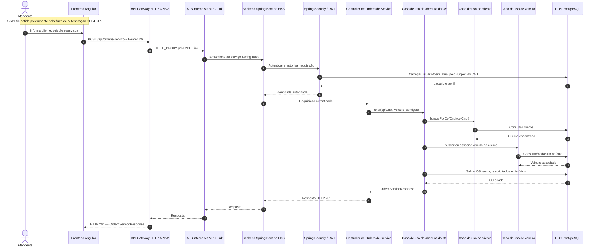

# Fluxo principal da Ordem de Serviço

Este diagrama representa o fluxo de abertura da OS, incluindo autenticação via JWT, encaminhamento pela API Gateway, processamento no backend Spring Boot e persistência no banco relacional.

