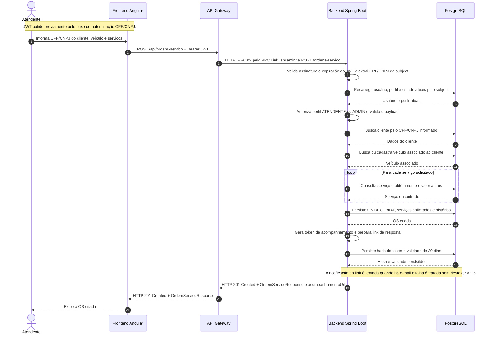

# Diagrama de sequência — Abertura da ordem de serviço

O fluxo resume a abertura autenticada de uma OS sem detalhar componentes internos do backend. Na rota externa do API Gateway, o frontend chama `POST /api/ordens-servico`; a integração remove `/api` e encaminha `POST /ordens-servico` ao backend. O contrato OpenAPI versionado descreve o endpoint do backend, protegido por Bearer JWT, e declara `201 Created` para a criação bem-sucedida. O diagrama de login CPF/CNPJ e emissão do JWT está na [arquitetura do API Gateway](https://github.com/autoflow-fiap/autoflow-infra/blob/docs%2Farchitecture-adrs-rfcs-20261102/docs/api-gateway/arquitetura.md).

## Referências

- [Contrato OpenAPI versionado](../openapi/autoflow-api.json)
- [Documentação e operação `POST /ordens-servico`](../openapi/README.md)
- [Arquitetura e rotas do API Gateway](https://github.com/autoflow-fiap/autoflow-infra/blob/docs%2Farchitecture-adrs-rfcs-20261102/docs/api-gateway/arquitetura.md)
