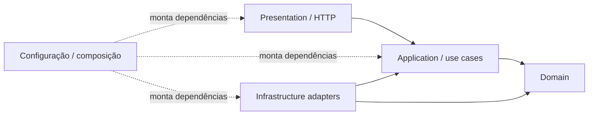

# RFC-001 — Migração incremental para Clean Architecture

- **Título:** RFC-001 — Migração incremental para Clean Architecture
- **Status:** Implementada.
- **Data:** 02/11/2026.
- **ADR relacionada:** [ADR-001 — Migração incremental para Clean Architecture](../adr/ADR-001-sequencia-migracao-clean-architecture.md)

## 1. Contexto e Problema

### Síntese executiva

O backend é um monólito Spring Boot que passou de uma organização por camadas técnicas para fronteiras explícitas de domínio, aplicação, apresentação e infraestrutura. A estratégia registrada foi migrar componentes em fatias, mantendo os contratos existentes e evitando uma reescrita global. O código atual contém essas camadas, gateways/adapters e testes arquiteturais; esta RFC descreve o padrão observável, não afirma que cada passo histórico foi implantado em uma ordem específica.

### Cenário anterior e motivação

O baseline histórico era `controller → service → mapper → repository → domain/JPA entity → database`. Serviços conheciam DTOs REST, mappers e repositories concretos; entidades JPA eram parte do pacote de domínio. Essa separação por tecnologia acoplava regras a HTTP e persistência, dificultava testes unitários e ampliava o raio de mudanças de schema ou framework.

A OS envolve orçamento, estoque, permissões, notificações, histórico e acompanhamento, ao passo que cadastros como `servico` têm fluxos menores. Uma alteração global poderia combinar movimentação de pacotes com regressões de comportamento e contrato. O valor pretendido é reduzir acoplamento e permitir evolução/testes isolados, sem mudar o uso do sistema pelo frontend ou outros consumidores.

### Objetivos e não objetivos

**Objetivos:** estabelecer dependências apontando para o núcleo; encapsular persistência e integrações atrás de gateways; manter DTOs/contratos REST; migrar por componente e usar testes para detectar regressões e violações de camada.

**Não objetivos:** decompor o monólito em microserviços; trocar Spring Boot, PostgreSQL, Flyway ou o modelo de autorização; alterar endpoints, payloads, status HTTP, schema/migrations ou regra de negócio como efeito colateral; declarar que a arquitetura não possui qualquer dependência técnica residual.

### Requisitos e restrições

- Preservar o contrato HTTP e o comportamento observável, incluindo autenticação/autorização e tratamento de falhas.
- Manter Flyway e o schema fora do escopo de uma refatoração puramente estrutural.
- Fazer mudanças pequenas e verificáveis, com baseline de sucesso e falha para o componente afetado.
- Reutilizar o stack Java/Spring existente; não foi registrado orçamento específico nem uma comparação quantitativa de custos.
- A ordem e os critérios de entrada de OS devem refletir seu risco e dependências cruzadas.

## 2. Proposta / Solução

### Visão e fronteiras adotadas

As setas representam dependências de código. A aplicação declara portas de saída (gateways); adapters concretos em infraestrutura implementam essas interfaces. `config` faz a composição Spring. A apresentação converte HTTP em inputs da aplicação e converte outputs em responses; não acessa JPA diretamente.

| Fronteira | Responsabilidade observada |
|---|---|
| `domain` | Entidades, políticas e regras sem dependência de Spring, JPA ou HTTP. |
| `application` | Interfaces `port/in`, implementações em `usecases`, entradas/saídas internas, políticas e gateways de saída. Alguns tipos ainda usam anotações Spring/Lombok; a dependência técnica residual está documentada. |
| `presentation` | Controllers, requests, responses, validações, mapeadores REST e handler HTTP. Mantém DTOs como contratos da borda. |
| `infrastructure` | Adapters, repositories e entities JPA, mappers de persistência, segurança, e-mail e demais integrações. |
| `config` | Beans e montagem das implementações, sem lógica de domínio. |

### Exemplo real: componente Serviço

`presentation.servico.ServicoController` recebe `ServicoRequest`, usa `CriarServicoUseCase` e converte o resultado para `ServicoResponse`. `CriarServicoUseCaseImpl` coordena validação e mapeamento de aplicação usando `application.gateway.ServicoGateway`. `infrastructure.persistence.adapters.ServicoRepositoryAdapter` implementa esse gateway e converte `Servico` para `ServicoEntity` por meio de `ServicoPersistenceMapper`, delegando a persistência ao Spring Data. O endpoint `POST /servicos` continua declarando resposta HTTP 201 e a autorização correspondente no controller.

Esse fluxo exemplifica o padrão implementado; não é instrução para mover arquivos nem substitui o OpenAPI como contrato.

### Estratégia técnica e testes

O registro inicial preferiu `servico` como piloto de menor risco, depois `cliente` ou `veiculo`, `pecainsumo`/estoque e OS após caracterizar fluxos e gateways. O estado atual mostra use cases e testes nos diferentes contextos, mas não permite deduzir por si só a cronologia de migração de cada componente. A migração deve ser feita como refatoração local, com contratos REST mantidos e mudanças funcionais separadas.

Os testes versionados cobrem unidades de domínio e casos de uso, adapters/mapeamentos, controllers, fluxos de integração `*IT.java` com PostgreSQL via Testcontainers e Flyway, além de `ArchitectureBoundaryTest` com ArchUnit. O OpenAPI e os testes de apresentação/integração documentam contratos; não foi identificado um verificador automatizado independente de breaking changes do OpenAPI. O `verify` do Maven também executa JaCoCo, cuja regra de bundle configurada é 80% para linhas e branches. Nenhum resultado de execução é inferido apenas pela existência desses arquivos.

## 3. Alternativas Consideradas

Não há registro de comparação formal das opções abaixo. A análise é retrospectiva e deriva do baseline e dos riscos registrados na ADR.

| Alternativa | Vantagens | Desvantagens | Impacto operacional/financeiro e motivo para não adoção |
|---|---|---|---|
| Migração incremental por componente (adotada) | Mudanças localizadas, verificação por fatia e priorização de menor risco. | Exige manter e revisar temporariamente padrões legados e novos. | Menor raio de regressão que uma reescrita, ao custo de mais etapas e revisão; escolhida por preservar continuidade e contratos. |
| Reestruturação global em uma etapa | Uniformiza a árvore de pacotes e termina rapidamente a coexistência. | Diff amplo, causalidade de falhas difícil e risco de misturar mudanças de regra/schema/contrato, particularmente em OS. | O custo de testes/revisão e recuperação seria concentrado; não escolhida pelo risco sem evidência de caracterização global suficiente. |
| Manter camadas técnicas anteriores | Sem custo de migração e com organização familiar. | Mantém domínio dependente de persistência/apresentação e encarece evolução/testes. | Menor custo imediato, mas não resolve o problema arquitetural que motivou a iniciativa. |

## 4. Impactos e Riscos

**Sistemas afetados:** backend Java/Spring e sua estrutura de pacotes, testes, configuração de composição e documentação. O frontend e consumidores HTTP dependem da compatibilidade do contrato. Persistência e migrations não deveriam mudar por causa da reorganização.

**Contratos e compatibilidade:** Requests, responses, paths, status HTTP e autorização continuam na borda `presentation`; qualquer alteração intencional de API ou regra deve ter mudança/spec própria. A migração estrutural não altera a topologia AWS nem requer feature flag.

**Segurança e privacidade:** a direção das dependências não substitui os testes de autenticação/autorização nem controles de tokens e dados pessoais. Casos de uso recebem contratos internos e não devem acoplar a API a entidades JPA.

**Performance e disponibilidade:** uma movimentação de código, sem mudança algorítmica ou de runtime, não prevê ganho mensurável de latência. Risco principal é regressão funcional/compilação em rollout, controlado por CI e testes; não há benchmark ou SLO de refatoração registrado.

| Risco | Tratamento |
|---|---|
| DTO HTTP, regra de autorização ou status divergir durante extração | Comparar OpenAPI, controller e testes do fluxo; separar mudança de contrato da refatoração. |
| Use case depender de Spring Data, entidade JPA ou pacote de presentation | Regras ArchUnit em `ArchitectureBoundaryTest`; revisão de imports e direção das dependências. |
| Adapter alterar conversão, transação ou semântica de persistência | Testes unitários do adapter/mapeador e integração com Testcontainers; revisar schema/Flyway separadamente. |
| Coexistência de estruturas criar atalhos ou duplicação duradoura | Migrar componente a componente e documentar exceções; o cronograma concluído por componente não está registrado nesta RFC. |
| Fluxos de OS sofrerem regressão transversal | Exigir caracterização abrangente e gateways para estoque, usuário, orçamento, notificação e histórico antes de separar sua estrutura. |

Custos de infraestrutura e operação externa não são alterados pela RFC. O custo interno é maior número de abstrações, testes e manutenção durante a coexistência.

## 5. Plano de Implementação / Rollout

### Pré-requisitos e sequência

1. Identificar um componente e mapear endpoints, DTOs, autorização, dependências, regras, persistência e falhas relevantes.
2. Registrar baseline de testes de sucesso/erro e verificar se migrations ou mudanças funcionais estão fora do diff.
3. Separar domínio e casos de uso; definir portas de entrada/saída internas onde o fluxo as exigir.
4. Implementar adapters de infraestrutura para os gateways; manter entities/repositories concretos fora do domínio/aplicação.
5. Manter controller, request/response e status HTTP, delegando a execução ao use case.
6. Executar suites unitárias, de integração/contrato disponíveis e de arquitetura; revisar OpenAPI e frontend/coleção Postman afetados.
7. Integrar por PR/CI e só então aplicar o padrão ao próximo componente. Para OS, concluir antes a caracterização ampla descrita na ADR.

Como a mudança é estrutural e não introduz novo comportamento selecionável, feature flag não é aplicável. A implantação usa o processo normal da aplicação somente quando o artefato de código for publicado; esta RFC não afirma que um deploy específico ocorreu.

### Estado observado

| Marco | Estado verificável nesta branch |
|---|---|
| Pacotes `domain`, `application`, `infrastructure`, `presentation` e `config` | Presentes no código atual. |
| Portas/use cases/adapters e teste de fronteiras | Presentes; `ArchitectureBoundaryTest` contém regras para dependências, portas, adapters, entities JPA, controllers e ciclos. Execução nesta revisão não realizada. |
| Migração por componente e ordem cronológica completa | ADR preserva a estratégia e o código mostra evolução; não foi encontrada evidência suficiente para afirmar a sequência exata concluída em cada componente. |
| Alterações de API/schema atribuíveis a cada etapa histórica | Não inferidas pelo estado atual; conferir commits e testes por mudança quando necessário. |

### Recuperação

Em falha de build/teste antes de integrar, corrigir ou reverter somente a fatia do componente. Se a regressão for observada após release, restaurar o último artefato/configuração compatível pelo fluxo de deploy existente e abrir correção isolada; não há mecanismo de rollback arquitetural automático ou migração de banco prescrita por esta decisão.

## 6. Critérios de Aceite e Métricas

Os critérios abaixo são verificáveis; “não verificável” significa que o teste/execução atual não foi realizado nesta revisão, não que o código esteja reprovado.

| ID | Requisito | Método / resultado esperado | Evidência versionada | Situação |
|---|---|---|---|---|
| CA-01 | Contrato HTTP permanece compatível para o componente alterado | Comparar paths, método, request/response, status e autorização contra OpenAPI e testes; nenhuma diferença sem mudança aprovada | `docs/openapi/autoflow-api.json`, controllers e testes `presentation`/`integration` | Não verificável — não executado nesta revisão |
| CA-02 | Regras centrais ficam independentes de adapters | `mvn -Dtest=ArchitectureBoundaryTest test`; regras ArchUnit devem passar sem dependência proibida ou ciclo | `backend/src/test/java/com/autoflow/architecture/ArchitectureBoundaryTest.java` | Não verificável — execução não realizada |
| CA-03 | Casos de uso cobrem sucesso e falhas relevantes | Executar testes de unidade do use case; resultados esperados e exceções permanecem estáveis | Testes em `backend/src/test/java/com/autoflow/application/usecases/` | Não verificável — execução não realizada |
| CA-04 | Persistência preserva mapeamento e comportamento | Executar testes de adapters e `*IT` com Testcontainers/Flyway; nenhum schema change não planejado | `backend/src/test/java/com/autoflow/infrastructure/persistence/` e `backend/src/test/java/com/autoflow/integration/` | Não verificável — execução não realizada |
| CA-05 | Build e gates gerais do backend passam | `cd backend && mvn clean verify`; resultado inclui testes, Failsafe e JaCoCo | `docs/testing-and-quality.md`, `backend/pom.xml` | Pendente — não executado nesta revisão |

Não há métrica de latência ou taxa de regressão atribuída à migração, nem resultado numérico de testes declarado aqui. A métrica operacional adequada é a ausência de alteração não aprovada em contrato/schema e a aprovação dos gates do componente antes de prosseguir.

## Referências

- [ADR-001 — Migração incremental para Clean Architecture](../adr/ADR-001-sequencia-migracao-clean-architecture.md)
- [Arquitetura e limites atuais](../architecture.md)
- [Convenção de pacotes](../conventions/package-convention.md)
- [ArchitectureBoundaryTest](../../backend/src/test/java/com/autoflow/architecture/ArchitectureBoundaryTest.java)
- [Exemplo de caso de uso](../../backend/src/main/java/com/autoflow/application/usecases/servico/CriarServicoUseCaseImpl.java)
- [Gateway](../../backend/src/main/java/com/autoflow/application/gateway/ServicoGateway.java)
- [Adapter de persistência](../../backend/src/main/java/com/autoflow/infrastructure/persistence/adapters/ServicoRepositoryAdapter.java)
- [Controller e DTOs](../../backend/src/main/java/com/autoflow/presentation/servico/ServicoController.java)
- [OpenAPI](../openapi/README.md) e [guia de testes](../testing-and-quality.md)
