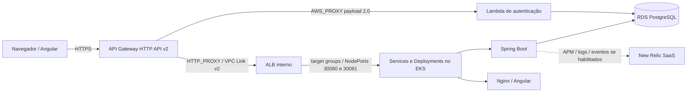

# RFC-002 — Kubernetes e Terraform para implantação do AutoFlow

- **Título:** RFC-002 — Kubernetes e Terraform para implantação do AutoFlow
- **Status:** Implementada.
- **Data:** 02/11/2026.
- **ADR relacionada:** [ADR-002 — Adoção de Kubernetes e Terraform](../adr/ADR-002-adocao-kubernetes-terraform.md)

## 1. Contexto e Problema

### Síntese executiva

O AutoFlow mantém Docker Compose para uso local e declara seis roots Terraform, distribuídos por quatro repositórios, para uma topologia AWS com EKS, RDS, Lambda, HTTP API, workloads Kubernetes e integração de observabilidade. Os roots têm States independentes e dependências que exigem execução ordenada. Os manifests, workflows e Plans não provam que a topologia esteja implantada ou operando atualmente.

### Cenário e problema

Compose atende à execução local, mas a configuração AWS precisa declarar rede, cluster, banco, autenticação, entrada HTTP e workloads com ownership e ciclo de vida revisáveis. Configuração manual produziria drift e não permitiria reproduzir com segurança a sequência de dependências. Separar a infraestrutura entre repositórios reduz ownership compartilhado, mas exige coordenação de State e pipeline.

### Objetivos e não objetivos

**Objetivos:** descrever topologia e responsabilidades existentes; provisionar infraestrutura e recursos Kubernetes por Terraform; manter configuração por ambiente, States separados, gates explícitos e procedimentos de recuperação; expor health checks e HPA declarados.

**Não objetivos:** afirmar produção operacional, autoscaling observado ou custo mensurado; converter Terraform Plan em Apply; criar orquestração automática entre todos os repositórios; descrever configuração AWS fora do código versionado.

### Requisitos e restrições

- `develop` seleciona `homolog`; `main` seleciona `production`, com Variables, Secrets e State keys próprios.
- EKS/VPC, RDS, Lambda, API Gateway e aplicação são roots/repositórios distintos, sem dependência de um único Apply global.
- CI valida código sem Apply; o caminho automático de CD, quando habilitado, gera Plan; Apply requer dispatch e gates configurados.
- O HPA de CPU depende de requests, API `metrics.k8s.io` e capacidade disponível no node group.
- State remoto não deve ser inicializado vazio ou compartilhado sem validar ownership e ambiente.
- AWS Learner Lab pode perder/expirar recursos e credenciais; recuperação precisa distinguir recursos AWS removidos de States preservados.

## 2. Proposta / Solução

### Topologia declarada

O desenho acima resume a configuração atual, apoiada pelo diagrama detalhado do API Gateway. A sequência de requisição pública e autenticação está descrita na [arquitetura de infraestrutura](https://github.com/autoflow-fiap/autoflow-infra/blob/develop/docs/api-gateway/arquitetura.md); o diagrama de deploy da Fase 2 é histórico, não deve ser usado como topologia atual.

### Componentes e responsabilidades

| Root / recurso | Responsabilidade observada |
|---|---|
| `autoflow-infra/infra` | VPC, subnets, Security Groups, EKS e node group. |
| `autoflow-db/infra` | RDS PostgreSQL privado e rede de banco. |
| `autoflow-lambda/infra` | Lambda Python de login, executada na VPC. |
| `autoflow-infra/infra/api-gateway` | HTTP API v2, rotas, integração Lambda, VPC Link, ALB interno, target groups e alarmes CloudWatch. |
| `autoflow/infra` | Deployments backend/frontend, Services internos e NodePort para ALB, ConfigMap e HPA via Terraform; o Secret de runtime é sincronizado pelo workflow protegido, sem seu valor no Terraform State. |
| `autoflow-infra/infra/newrelic` | Release `nri-bundle`, dashboard, condições NRQL e Synthetic opcionais. |

O backend e o frontend são containers publicados com tags fornecidas pelo workflow. O backend declara requests/limits, probes de startup/readiness/liveness; o ALB testa `/actuator/health/readiness` e `/` para seus target groups. Services internos são `ClusterIP`; os Services de gateway expõem NodePorts `30081` (backend) e `30080` (frontend) para o ALB.

### Terraform, State e configuração

Cada root possui State remoto S3 próprio, distinto por ambiente: `vpc_eks`, `rds`, `lambda`, `application`, `api_gateway` e `newrelic`. O root da aplicação consulta o State RDS e consulta o cluster EKS; o API Gateway consome outputs de VPC/EKS e consulta Lambda/EKS; Lambda e New Relic também dependem de roots externos. A matriz/keys são fornecidas por GitHub Environments, sem IDs de conta embutidos nesta RFC. Os roots não são executados como um único grafo por uma pipeline transversal.

O Terraform da aplicação usa `kubectl_manifest` para aplicar Deployments, Services, ConfigMap e HPA. As credenciais do runtime são fornecidas ao processo protegido do pipeline para criar/atualizar o Kubernetes Secret; seu conteúdo não deve ser documentado ou colocado no state/configuração em texto aberto. Terraform da infraestrutura consulta recursos existentes quando o root não os possui.

### HPA, health e recuperação

`k8s/hpa.yaml` usa `autoscaling/v2`, alvo médio de 50% da CPU e faixa 1–3 réplicas. `k8s/backend-deployment.yaml` declara request de 250m CPU e limite de 500m; também declara probes para o Actuator. `infra/k8s-deployment.tf` gerencia o HPA após o Deployment e ignora `spec.replicas` no Terraform para que o controlador HPA defina réplicas.

Não foi encontrada declaração de Metrics Server/adapter que assegure `metrics.k8s.io`; esse pré-requisito deve ser confirmado no cluster. O HPA não aumenta automaticamente a capacidade de nodes por si só e o autoscaling do node group depende da configuração AWS/cluster.

## 3. Alternativas Consideradas

As comparações são retrospectivas; o histórico da ADR não registra teste formal ou benchmark de custo entre provedores/plataformas.

| Alternativa | Vantagens | Desvantagens | Impacto e motivo para não adoção |
|---|---|---|---|
| Docker Compose como plataforma principal | Menos componentes e operação simples em uma máquina; segue útil no desenvolvimento local. | Não oferece, sozinho, o mesmo modelo de reconciliação/escala de workloads distribuídos e exige estratégia adicional para HA, rollout e monitoramento. | Evita custos de EKS, mas não atende a topologia distribuída declarada; mantido apenas para uso local. |
| ECS/Fargate | Serviço gerenciado AWS e menor responsabilidade direta sobre o cluster Kubernetes e nodes. | Requer adaptar manifests, deployment, operadores e experiência de suporte; custo não comparado para a carga do AutoFlow. | Tecnicamente possível, mas não escolhido; os recursos e manifests existentes são Kubernetes/EKS. |
| EKS/Kubernetes (adotado) | Modelo declarativo de Deployments/Services/HPA e compatibilidade com manifests atuais. | Exige operação de cluster, nodes, métricas, rede e permissões; custos e dependência AWS. | Decisão registrada e refletida nos roots; não se alega superioridade por benchmark. |
| Provisionamento manual | Pode ser direto para bootstrap ou intervenção pontual. | Difícil repetir, revisar, detectar drift e relacionar recursos a ownership; maior risco de diferenças entre ambientes. | Não adotado como fluxo ordinário; controles pontuais de bootstrap continuam limitados e documentados. |
| Terraform (adotado) | Código e Plan versionados, diffs revisáveis, dependências e backend por root. | State remoto sensível, providers podem alterar recursos e Apply errado tem efeito real; curva operacional. | Adotado para IaC. Manual não substitui State nem pode editar os recursos sem reconciliação explícita. |

## 4. Impactos e Riscos

**Sistemas afetados:** AWS VPC/EKS, RDS, Lambda, HTTP API, New Relic, Kubernetes, imagens Docker e workflows dos quatro repositórios.

**Contratos e APIs:** `POST /auth/login` e rotas frontend/backend seguem o catálogo do API Gateway e contratos da aplicação; recursos de infraestrutura não alteram payloads REST. Mudanças de NodePort, probe, route ou cluster afetam tráfego e precisam ser coordenadas entre roots.

**Segurança e privacidade:** acesso protegido por IAM, Security Groups, Secrets/Variables e GitHub Environments; States e Plans podem conter dados sensíveis e devem permanecer cifrados/protegidos. Configuração declarada de rede não prova isolamento efetivo em runtime.

**Performance/disponibilidade/escalabilidade:** probes ajudam a detectar readiness/liveness e HPA declara escala por CPU. Disponibilidade real depende de targets saudáveis, capacidade do cluster, banco e conectividade; não há SLO/latência global declarado nesta RFC.

**Custos/manutenção:** EKS, nodes, VPC/NAT, ALB, RDS, API Gateway e telemetria implicam custos recorrentes e operação em múltiplas ferramentas. Não há estimativa financeira comparativa disponível. Estados distintos reduzem conflito de ownership, mas elevam coordenação e risco de dependências desatualizadas.

| Risco | Mitigação / limite |
|---|---|
| Apply na conta, ambiente ou State incorreto | Validar identidade AWS/ambiente/keys, usar gates e Plan vinculado ao commit; interromper diante de State inesperado. |
| Recursos removidos após reset do Learner Lab com State remoto preservado | Executar bootstrap isolado quando necessário, validar owner e keys, revisar Plan e reaplicar roots na ordem documentada; nunca iniciar State vazio sobre recursos existentes. |
| Roots executados fora de ordem | Seguir dependências; pipeline não orquestra automaticamente os repositórios. Confirmar outputs antes do Plan consumidor. |
| HPA sem métricas/capacidade ou com requests incorretos | Validar `metrics.k8s.io`, requests e capacity; não considerar o YAML prova de escala observada. |
| Target group indisponível durante rollout | Verificar probes e `HealthyHostCount`; manter frontend/backend deployment e NodePorts sincronizados com listeners/target groups. |
| Rollback incompleto de State ou imagem | Gerar novo Plan após corrigir configuração; reverter código/imagem por fluxo declarativo e preservar States; não há rollback global automático. |

## 5. Plano de Implementação / Rollout

### Pré-requisitos e ordem

1. Preparar GitHub Environments `homolog`/`production`, credenciais temporárias corretas, Variables/Secrets, proteção de branches e reviewers efetivos. A existência real dessas proteções no GitHub deve ser confirmada por administradores.
2. Validar matriz de seis State Keys exclusivas por ambiente. Se o bucket não existir, executar o job de bootstrap isolado; esse job não inicializa Terraform nem executa Plan/Apply.
3. Para cada root, gerar e revisar um Plan novo. Ordem documentada: `autoflow-infra` VPC/EKS → `autoflow-db` RDS → `autoflow-lambda` → `autoflow-infra` API Gateway/VPC Link/ALB → `autoflow` aplicação Kubernetes → `autoflow-infra` New Relic.
4. Confirmar outputs e recursos predecessores antes do Plan dependente; nenhum workflow entre os quatro repositórios garante automaticamente essa sequência.
5. PR/CI aplica `terraform fmt`, inicialização sem backend remoto/validate e testes configurados. CI não equivale a provisionamento.
6. Push pode executar Plan automático somente se Repository Variable opt-in e CI do mesmo SHA forem aprovadas. `workflow_dispatch` com `apply=false` é Plan; Apply exige `apply=true`, artefato Plan da execução, guards e aprovação do Environment. O Plan sozinho nunca aplica.
7. Após aplicação autorizada, validar status dos Deployments, probes, Services/NodePorts, target groups, login/rotas e conectividade. Smoke tests disponíveis são executáveis apenas em seus fluxos configurados; execução recente não foi verificada.

### Situação atual e recuperação após reset

As etapas de topologia, roots, manifests e workflows estão representadas no código, mas esta revisão não consultou a AWS nem resultados de execução. Portanto nenhum passo é declarado como deploy recente ou produção operacional.

Após reset/perda de recursos do Learner Lab, confirmar conta/região por STS, existência e ownership do bucket, State keys e quais recursos persistem. Se ausente, usar o bootstrap isolado descrito em `docs/state-bucket-bootstrap.md`. Diagnosticar EKS/node group, preservar States e gerar Plans por root; reaplicar somente após revisar drift e dependências na ordem acima. Se o State estiver ausente ou ownership for ambíguo, parar e seguir o runbook de recuperação/reconciliação; não fazer `state rm`, importar ou `destroy` improvisado.

### Rollback / recuperação

Rollback é uma nova mudança declarativa revisada por Plan e Apply aprovado. Recuperar imagem anterior requer que a imagem/tag aprovada continue disponível; restaurar configuração de infraestrutura exige revisar os efeitos colaterais no State e nos roots dependentes. O workflow não declara rollback automático de toda a topologia. Em caso de falha, interromper roots consumidores e diagnosticar recursos/Health checks antes de nova aplicação.

## 6. Critérios de Aceite e Métricas

| ID | Requisito | Método / resultado esperado | Evidência versionada | Situação |
|---|---|---|---|---|
| CA-01 | Root de aplicação está formatado e válido | `terraform fmt -check -recursive infra`, `terraform init -backend=false -input=false` e `terraform validate` sem erro | `.github/workflows/ci.yml`, `infra/` | Pendente — comandos não executados nesta revisão |
| CA-02 | HPA tem limite e métrica declarados e Deployment fornece requests | Inspecionar manifest: mínimo 1, máximo 3, CPU 50%, requests presentes; runtime exige `metrics.k8s.io` | `k8s/hpa.yaml`, `k8s/backend-deployment.yaml`, `infra/k8s-deployment.tf` | Parcialmente validado — configuração inspecionada; comportamento do cluster não verificado |
| CA-03 | Health checks de backend e targets correspondem | Verificar readiness/liveness/startup probes, health do target group e `HealthyHostCount` após deploy | Manifest backend e módulo `autoflow-infra/infra/api-gateway/modules/private-eks` | Não verificável — runtime não consultado |
| CA-04 | Roots usam State distinto e dependências corretas | Validar matriz externa com `terraform_state_contract.py`; keys por ambiente únicas e producers/consumers coerentes | `docs/eks-primeiro-provisionamento.md`, `docs/api-gateway/arquitetura.md#states-e-ownership` | Não verificável — configuração externa/States não consultados |
| CA-05 | CI não aplica; Apply requer dispatch e gates | Inspecionar workflow: Plan separado; Apply só em dispatch `apply=true` e artifact do Plan | `.github/workflows/pipeline.yml` e workflows dos roots | Parcialmente validado — definição versionada inspecionada; approvals efetivos não verificados |
| CA-06 | Após rollout, workloads e rotas respondem e recuperam | `kubectl rollout status`, readiness probes, targets saudáveis, smoke de login/rotas e teste de recuperação autorizado | `docs/api-gateway/runbook.md`, workflows de smoke | Não verificável — sem evidência de execução atual |
| CA-07 | Plano pós-reset não sobrescreve State existente | Bootstrap isolado, confirmar bucket/owner, validar State e revisar Plans de cada root antes de Apply | `docs/state-bucket-bootstrap.md`, `docs/newrelic-state-migration.md` | Não verificável — nenhuma operação AWS executada nesta revisão |

Os resultados de latência, taxa de erro, disponibilidade e scaling não têm metas de SLO/valor de aceite numéricas comuns a todos os ambientes. Os limites de HPA, probes e alarmes são configuração declarada, não métricas de execução observadas.

## Referências

- [ADR-002 — Adoção de Kubernetes e Terraform](../adr/ADR-002-adocao-kubernetes-terraform.md)
- [README e ordem dos roots](../../README.md#ordem-de-provisionamento)
- [Topologia e States do API Gateway](https://github.com/autoflow-fiap/autoflow-infra/blob/develop/docs/api-gateway/arquitetura.md)
- [Runbook de primeiro provisionamento](https://github.com/autoflow-fiap/autoflow-infra/blob/develop/docs/eks-primeiro-provisionamento.md)
- [Bootstrap isolado do bucket](https://github.com/autoflow-fiap/autoflow-infra/blob/develop/docs/state-bucket-bootstrap.md)
- [Runbook de recuperação de nós EKS](https://github.com/autoflow-fiap/autoflow-infra/blob/develop/docs/eks-node-recovery.md)
- [Deployments, Services e HPA da aplicação](../../infra/k8s-deployment.tf), [`k8s/`](../../k8s/)
- [CI/CD da aplicação](../../.github/workflows/ci.yml) e [guia de qualidade](../testing-and-quality.md)
